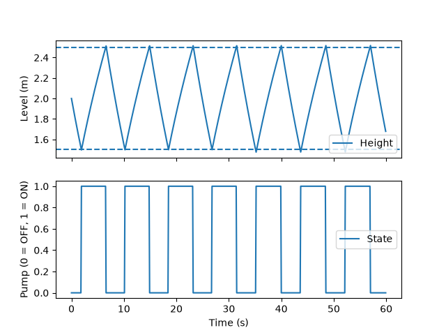
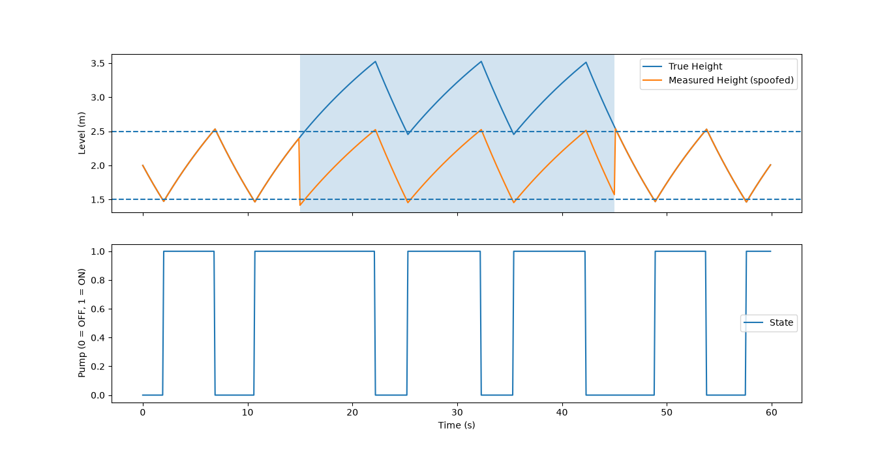
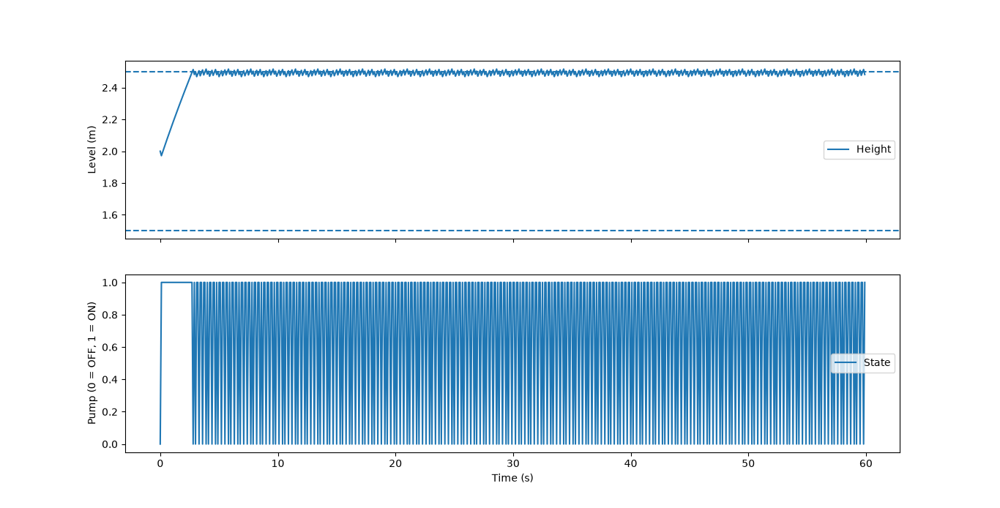

# PLC Scan Cycle and Sensor Spoofing

**Date:** 20 November 2026
**Roadmap item:** Phase 1, Section 3, Item 2 (PLCs and the scan cycle)

## Purpose
This note explains how a PLC scan cycle works, how simple control logic with hysteresis is written, and how a PLC can be fooled by a falsified sensor reading. It uses a simulated water tank to show the effect.

## Background
**Scan cycle.** A PLC repeats one loop continuously: it reads all inputs as a snapshot, runs its control logic on that snapshot, then writes the outputs. Because the logic only sees the snapshot, a false input is treated as true.

**Hysteresis and latching.** The pump switches ON below a low threshold (1.5) and OFF above a high threshold (2.5). Between them it keeps its previous state, which is stored between scans. This memory is called a latch. Two thresholds stop the pump from rapidly switching on and off near a single limit.

**Ladder vs Structured Text.** Ladder Diagram is a graphical language that resembles electrical relay circuits mostly used to trouble shoot and understand a logic. Structured Text is a written language similar to ordinary code which make it easier to write loops and long logic. 

## Method
- **Tank model:** dh/dt = (Q_in - c*sqrt(h)) / A, with A = 1, c = 0.2, solved with an Euler step (dt = 0.1 s) for 60 s, starting at 2.0 m.
- **Controller:** a PLC-style scan every 0.1 s. Pump ON below 1.5, OFF above 2.5, with Q_in = 0.5 when the pump is ON.
- **Spoof:** between 15 s and 45 s, the PLC reads the true level minus 1.0.
- **Comparison run:** the same controller with a single threshold instead of a band.

Code: `water-tank/closed_loop_tank.py`

## Results
**1. Normal operation.** The pump cycles about 7 times in 60 s (14 switches), and the level stays near the 1.5-2.5 band. It overshoots the thresholds by about 0.02 m, because the pump only reacts at the next scan.

**2. Spoofed sensor.** During the spoof, the PLC saw normal cycling, but the true level was shifted up by 1.0 and peaked near 3.5 (2.5 to 3.5 during the attack), 1.0 above the 2.5 switch-off threshold.

**3. Single threshold vs hysteresis.** With a single threshold of [x], the pump switched about 300 times in 60 s. With the two-threshold band it switched about 14 times.

## Interpretation
The PLC could not see the attack. Its logic only works on the reading it receives, and the spoofed reading stayed inside the normal band, so nothing looked wrong from the controller's side.

A physics-model detector would see it. It would run the same tank equation, driven by the pump commands, to predict the level. Normally the predicted and measured levels agree. During the spoof they differ by about 1.0, and that gap is the alarm signal.

## Three attacks on PLCs
1. **Spoofed inputs:** falsify a sensor reading so the logic makes a wrong decision (simulated in this note).
2. **Forced outputs:** override the PLC's output so the pump runs regardless of its logic (described, not simulated).
3. **Modified logic:** change the program itself, for example the thresholds or a safety check (described, not simulated).

## What I got wrong
I first predicted that the true level would be lower than the reading during the spoof. The sign was backwards. The PLC reads true level minus 1.0, so the true level is the reading plus 1.0, and it runs higher than the controller believes.

## Limitations
- A simple model with an Euler step and no sensor noise
- One kind of spoof, a constant offset
- No overflow limit in the model, so "unsafe" here means leaving the designed operating band
- No network, communication delays or real PLC hardware

## Open questions
- Once sensor noise is added, how large must the spoof be before a physics-model detector can reliably catch it?
- How should the alarm threshold on the gap between prediction and measurement be chosen?
- Would a slowly drifting spoof be harder to detect than a sudden one?